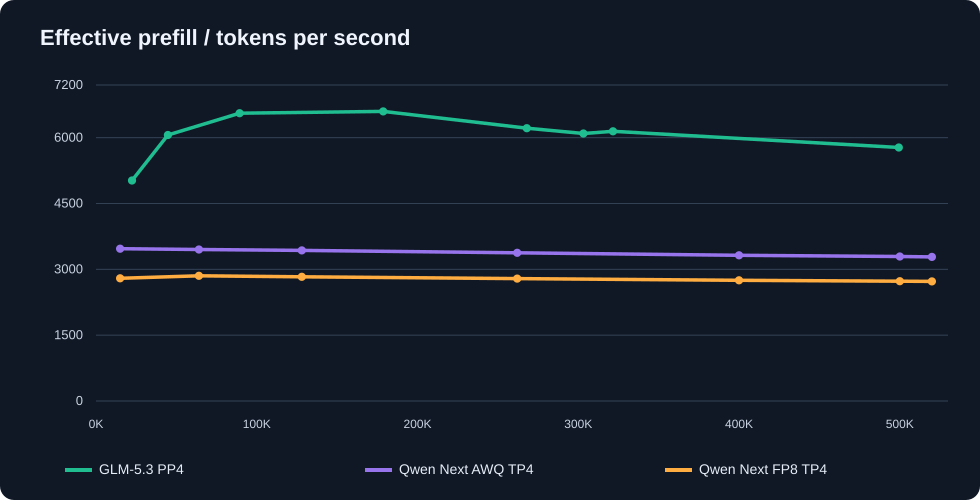
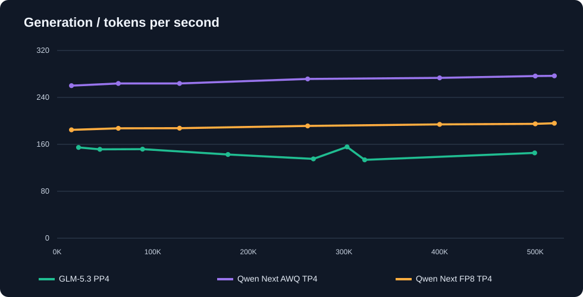
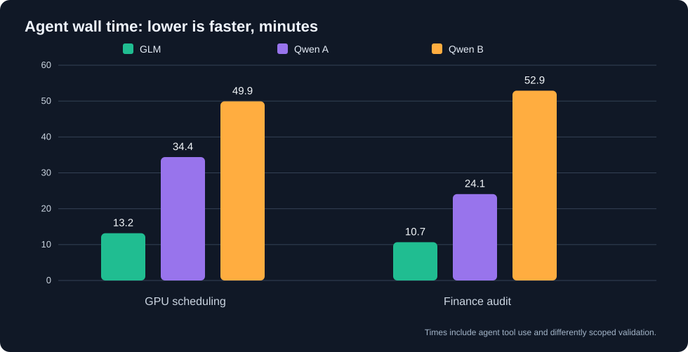

# GLM-5.3-Flash vs Qwen3.8 Flash-Next FP8 / AWQ — 4× CMP 170HX

**GLM follow-up — eight coding tasks:** [solution-free individual prompts and run protocol (RU)](coding-8-tasks/README_RU.md) · [all eight statements](coding-8-tasks/TASKS_ONLY_RU.md). **GLM's eight-task results are pending**; no score or elapsed time has been invented.
**Real-world benchmark and coding-agent follow-up, 14 October 2026.** [Русский](README_RU.md) · [Original Qwen AWQ/FP8 article](../flash-next-awq-vs-fp8/README.md)

We added GLM-5.3-Flash (mixed AWQ W4A16/W8, MTP-Q8) to the existing Qwen Next FP8/AWQ long-context comparison and tested two substantial coding-agent challenges. Measurements come from the operator's CMP 170HX server, the original Qwen comparison CSV and the actual agent-session traces.

**Headline:** GLM successfully processed **499,403 prompt tokens + 1,024 generated tokens** in **93.506 seconds**. Its **effective prefill was 5,775.4 tokens/s**, decode **145.4 tokens/s**, first token after **86.470 s**. GLM also found the correct GPU-scheduling optima (811/806) and financial payouts (10,732/9,855 kopecks). A real missed finance regression was subsequently repaired and independently retested.

## The server

| Item | Configuration |
|---|---|
| GPUs | 4× NVIDIA CMP 170HX, GA100/SM80, unlocked 64 GiB HBM2e each (256 GiB total) |
| Connection | PCIe Gen2 ×16, single-NUMA EPYC, no NVLink |
| CPU/RAM | AMD EPYC 7F52 16C/32T; 128 GB DDR4 |
| Software | Debian; NVIDIA driver 610.57.04 |
| GLM checkpoint | GLM-5.3-Flash-AWQ-W4A16-aggr-w8-mtpq8c-int4g32-mixA |
| GLM server | Custom vLLM 0.1.dev20051+g487ecf187; PP4 (14/11/11/9 layers), TP1; BF16 KV; MTP4 |
| GLM max request | 524,288 tokens, GPU memory utilization 0.91 |
| Qwen Next | FP8 and AWQ SM80-compatible vLLM setups from [prior paper](../flash-next-awq-vs-fp8/README.md); TP4, MTP4, AWQ uses EP/Marlin; YaRN 524,288 |

GLM did **not** use the Qwen-specific YaRN/MRoPE overrides. Neither a 1M single-request context nor 500K factual retrieval quality has been established.

## 1. Long-context inference

**Methods differ:** The original Qwen FP8-vs-AWQ study used exact-token unique-prefix cold prompts and 512 generated tokens. The GLM curve combines previous long-context observations with new unique-prefix, repeated-synthetic-text runs (1,024 generated tokens for the 303K and 499K points); the GLM script estimates request size instead of pre-tokenizing to an exact count. GPU parallelism, checkpoint, kernels, offload, prompt contents and output length also differ. **The plotted vertical distance is not a controlled speedup measurement.** Effective prefill equals actual prompt tokens / TTFT and includes first-token overhead.

### GLM numbers

| Actual prompt tokens | Prefill tok/s | Decode tok/s | TTFT | End-to-end |
|---:|---:|---:|---:|---:|
| 22,368 | 5,025 | 154.7 | 4.49 s | — |
| 44,697 | 6,061 | 151.5 | 7.44 s | — |
| 89,357 | 6,557 | 151.8 | 13.78 s | — |
| 178,681 | 6,598 | 142.7 | 27.47 s | — |
| 268,001 | 6,216 | 135.2 | 43.77 s | — |
| 303,213 | 6,095.9 | 155.6 | 49.741 s | 56.315 s |
| 321,593 | 6,146 | 133.6 | 53.23 s | — |
| **499,403** | **5,775.4** | **145.4** | **86.470 s** | **93.506 s** |

The last run used **500,427 out of 524,288 possible tokens** including output. The test command's nominal 560,000 target produced just 499,403 **actual** input tokens. It was therefore a genuine near-500K request, not 560K. This benchmark measures throughput, **not** whether the model recalls arbitrary facts in the middle of 500K tokens.

### Previous Qwen reference: matched within the Qwen study

| Actual prompt | FP8 prefill | AWQ prefill | FP8 decode | AWQ decode |
|---:|---:|---:|---:|---:|
| 15,004 | 2,796.7 | 3,469.0 | 184.7 | 260.1 |
| 128,001 | 2,830.8 | 3,431.9 | 187.5 | 263.8 |
| 262,006 | 2,789.1 | 3,377.6 | 191.4 | 271.5 |
| 500,008 | 2,729.0 | 3,293.2 | 194.9 | 276.5 |
| 520,005 | 2,725.7 | 3,284.1 | 195.9 | 276.8 |

Within this earlier *paired Qwen* test AWQ was roughly **21% faster in prefill and 41% in decode** than FP8. Those percentages must not be repurposed as GLM-vs-Qwen gains.

Data: [GLM CSV](data/glm_long_context.csv) · [Qwen reference CSV](data/qwen_reference.csv) · [GLM benchmark script](bench_vllm_glm53_cold.py).

## 2. Two coding-agent challenges

The full original Russian challenge prompts are provided without answers: [GPU scheduling](challenges/GPU_SCHEDULER_ORIGINAL_RU.md) and [financial audit](challenges/FINANCE_AUDIT_ORIGINAL_RU.md). They require executable Python and actual tests.

| Challenge | GLM | Qwen Next A | Qwen Next B |
|---|---:|---:|---:|
| **GPU scheduler**: elapsed agent time | **13.18 min** | ~34.4 min | ~49.94 min |
| GPU tool calls | 28 | 143 | 81 |
| GPU tests | **27/27 independently rerun** | 53/53 reported | 49/49 reported |
| **Financial audit**: elapsed agent time | **10.67 min** | ~24.08 min | ~52.9 min observed |
| Finance tool calls | 38 | 70 | 106 |
| Finance tests | **21/21 independently rerun** | 48/48 reported | 26/26 reported |

**GPU task:** Restore two historical snapshots from delayed/deduplicated events; exact combinatorial optimization for 18 jobs on four GPUs subject to memory/power/PCIe/dependency/exclusion constraints; reproducible proof. **All three found S1=811 and S2=806**. Different test counts are not equivalent test suites.

**Finance task:** Integer-kopeck discounts, commission, reserves, shipments, refunds, penalties and historic cutoffs, plus Python and PostgreSQL 16. Correct independently checked order payouts: S1 **A=2,030; B=2,382; C=6,320; total 10,732**. S2 **A=2,030; B=1,505; C=6,320; total 9,855**. GLM SQL was exercised by its agent, but PostgreSQL was not independently redeployed in this review.

**Run attribution warning:** Historical Qwen agent archives expose the same *served API model ID* across different checkpoints. FP8-versus-AWQ identity cannot be independently determined from the session JSON alone, so the agent times are labeled **Qwen A/B**, not arbitrarily assigned to quantizations. One 52.9-minute archive also has no clean final turn marker. Times include variable work by tools and are **not** a pure inference-speed contest.

Session data: [CSV](data/agent_sessions.csv).

## 3. Hidden regression, then fix

Independent review of GLM's first finance code found a historical reproducibility defect: a conflict check occurred **before** filtering events with ingested_at at or before the requested cutoff. Thus a conflicting e05 copy arriving at 12:30 could break the old 12:00 report.

After receiving a concrete counterexample, GLM reproduced **25/28 passing (three failures)**, fixed the filtering order and reached **28/28 passing**, independently rerun. It kept S1/S2 totals unchanged, and detectable conflicts remain errors when both copies are visible. The follow-up took **2 min 13 s**.

One unresolved distinction: Python raises EventConflictError for a snapshot after a conflict, whereas the SQL implementation logs a conflict but returns a numeric result. PostgreSQL behavior was seen in the agent log, **not** independently reproduced; it should be aligned before production use. The agent also had visibility of a prior Qwen work folder, which limits experimental isolation; no evidence of code copying was established.

## Verdict and reproducibility

GLM has demonstrated functional ~500K input on these four cards and successful core results on both engineering tasks. Qwen Next AWQ remains an excellent fast decode choice in the previous same-family paired study. **Neither these data nor different test counts prove one model is universally more intelligent.**

For a fair definitive ranking, rerun the same prompts and hidden tests with exact model verification, isolated directories, matched agent budgets, multiple trials and identical tokenization-based cold input generation. A real long-context *retrieval* test, not just synthetic throughput, remains essential.

Publication includes curated CSVs, SVG figures, original task prompts and the exact GLM synthetic benchmark script. The raw agent ZIPs are **not** uploaded because they can contain irrelevant local tooling and server details. Prior quality scores on eight smaller Qwen coding tasks (AWQ 78/80, FP8 79.5/80, dense 27B 77/80 on two GPUs) are documented in the [earlier article](../flash-next-awq-vs-fp8/README.md).
