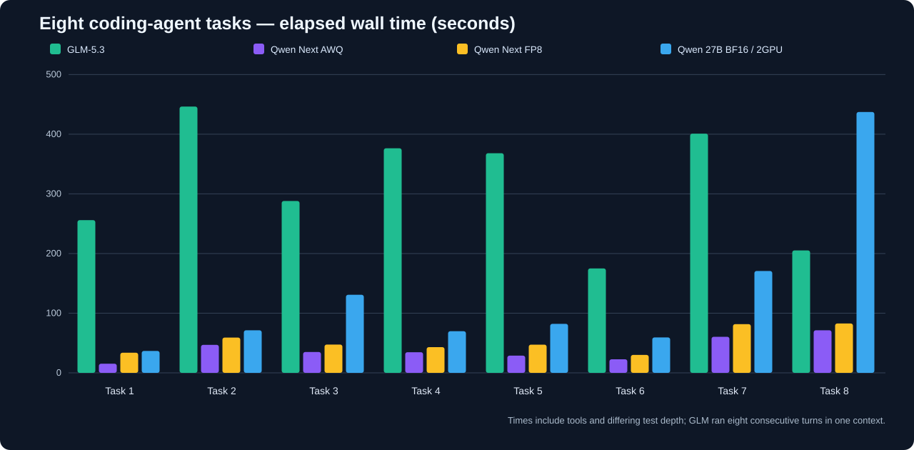
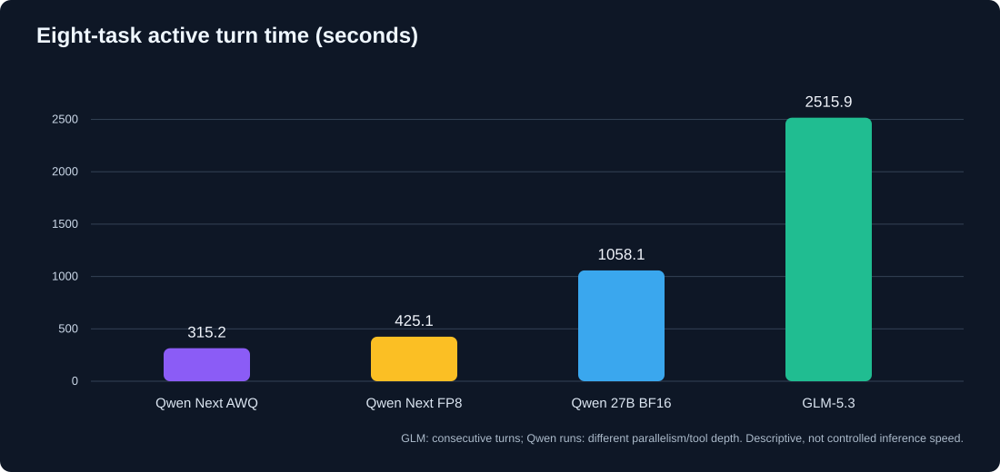

# GLM-5.3-Flash: результат восьми coding-agent задач
**Сессия от 14 октября 2026 · предварительная проверка · [English](RESULTS_EN.md) · [Условия без решений](TASKS_ONLY_RU.md) · [Основная статья](../README_RU.md)**

Восемь тестов из прежней [статьи о Qwen Next FP8, Next AWQ и Qwen 27B BF16](../../flash-next-awq-vs-fp8/README_RU.md) повторены на **GLM-5.3-Flash AWQ** с 4× CMP 170HX / PP4 / MTP4. Источник новых цифр — архив сессии DSH; измерение времени: разность событий `turn/start` и `turn/end` внутри каждого из восьми turn.

> **Существенное отличие методики:** GLM получила восемь задач в **восьми последовательных turn одной агентной сессии**, а не в восьми полностью изолированных новых сессиях. Восьмой вызов оперировал уже значительно увеличившимся контекстом. Кроме того, GLM проводила больше собственных запусков тестов и исправлений, чем модели в ряде исходных коротких прогонов. Следовательно, время — описание именно этих сессий, **не доказательство чистого отношения скорости моделей**. Первые три конфигурации Qwen взяты из предыдущего опубликованного CSV; Qwen 27B использовала **2 GPU / TP2**, остальные — 4 GPU.

## Время каждого теста

| Задача | GLM, с | Qwen AWQ, с | Qwen FP8, с | Qwen 27B BF16, с |
|---|---:|---:|---:|---:|
| 1. Python-сессии | **255,9** | 15,3 | 33,8 | 36,7 |
| 2. AsyncCache | **446,3** | 46,9 | 59,1 | 71,4 |
| 3. Покрывающий диапазон | **288,1** | 35,0 | 47,4 | 130,8 |
| 4. PostgreSQL | **376,4** | 34,6 | 43,1 | 69,8 |
| 5. TypeScript parsePort | **368,2** | 28,8 | 47,3 | 82,1 |
| 6. Storage | **175,1** | 22,8 | 30,1 | 59,4 |
| 7. LRU + TTL | **400,9** | 60,5 | 81,6 | 170,7 |
| 8. Async run_jobs | **205,1** | 71,4 | 82,7 | 437,2 |
| **Сумма активного времени** | **2515,9** | **315,2** | **425,1** | **1058,1** |

Для GLM: **41 мин 56 с** — сумма времени восьми обращений; **~67 мин 15 с** — полное время сессии от начала первого до конца восьмого turn **включая паузы между ними**. Зафиксировано **103 шага агента, 107 вызовов инструментов**, а также реальное создание файлов и запуски Python/TS/PostgreSQL.

[Скачать данные CSV](data/elapsed_comparison.csv).

## Проверка корректности

| Задача | Наблюдение и уровень проверки |
|---|---|
| **1. Группировка сессий** | Сортировка копии, строгая граница 30 минут, `O(n log n)`. Собственные Python-тесты GLM **повторно выполнены независимо**, проходят. |
| **2. AsyncCache** | Общая in-flight задача на ключ, параллельность разных ключей, повтор после сбоя, `asyncio.shield` при отмене клиента. Собственные Python-тесты **повторно пройдены**. |
| **3. Покрывающий диапазон** | Куча размера K и `O(N log K)`; проверки, включая генерацию на 1 млн значений, **повторно выполнены**. |
| **4. PostgreSQL** | В агентном журнале есть реальный PostgreSQL 16, проверки на специально построенных данных и 1 млн заказов; SQL на отдельной чистой базе в данном обзоре **не запускался**. |
| **5. parsePort** | **Несовместимость с эталонной семантикой.** Опубликованное решение Qwen возвращает fallback для ошибочного явно переданного `value`; GLM бросает `RangeError`. Это воспроизведено отдельно на `parsePort("8080abc", 3000)`. Сжатое ТЗ допускает неоднозначное чтение слова «отклонять», поэтому это сравнение с **опубликованным эталоном**, а не бесспорное нарушение всех возможных трактовок. |
| **6. Storage** | Регистр email при поиске игнорируется, возвращаемые объекты копируются/замораживаются. **Изменён интерфейс относительно опубликованного Python-примера:** вместо `register(email, name)` / `login(email)` GLM написала TypeScript API `register(email, password)` / `login(email, password)` — нельзя считать реализацию полностью взаимозаменяемой. TS-модули отдельно компилируются; собственные тесты запускались агентом. |
| **7. LRU + TTL** | Основные LRU/TTL-правила реализованы, но отдельно обнаружен **контрпример к поведению расширенного API GLM:** при разных TTL на `put` алгоритм бюджетной зачистки может вытеснить живой ключ, пока в кэше находится просроченный. В исходном кратком задании TTL на каждый `put` отдельно не требовался, поэтому эту находку не следует без оговорок считать провалом исходной задачи. |
| **8. Async run_jobs** | Собственные Python-тесты **повторно пройдены**. Независимый контрпример: если один job сам выбрасывает `asyncio.CancelledError`, GLM прерывает `run_jobs` и отменяет остальные воркеры. Это расходится с требованием, что исключение одной job не отменяет остальные, и отличается от опубликованного эталона, который различает собственную отмену job и внешнюю отмену всего runner. |

GLM сообщала о **57 проверках в задаче 5, 37 в задаче 6, 49 в задаче 7**; эти числа относятся к **её собственным** тестам и не эквивалентны независимому скрытому набору. Python-проверки задач 1, 2, 3 и 8 запущены повторно в отдельном окружении. Основные TypeScript-модули 5, 6 и 7 скомпилированы отдельно; полный пакет Node-зависимостей агентских TS-тестов в отдельном окружении не воспроизводился.

## Почему нет числа «GLM / 80» прямо сейчас

Ранее Qwen FP8 получила **79,5/80**, Qwen AWQ — **78/80**, Qwen 27B BF16 — **77/80** по авторской ручной шкале. Для корректного добавления четвёртого балла нужно повторить **одинаковый набор независимых тестов** для всех четырёх решений. Выявленные расхождения GLM документированы, но выставлять точный сопоставимый балл по разным наборам проверок было бы вводящим в заблуждение. Таким образом, **оценка GLM по шкале /80 пока не назначена**.

## Методические ограничения и дальнейший план

1. Точные опубликованные краткие формулировки тестов доступны в [отдельных файлах](README_RU.md), но они не подменяют полные архивы первоначальных Qwen сессий.
2. Отправить GLM уточнение для `parsePort`: что делать с явно переданным неверным портом — вернуть fallback (как в эталоне) или бросить исключение; отдельно проверить интерфейс Storage.
3. Проверить реальные скрытые случаи `CancelledError` и вытеснения при TTL на всех моделях, фиксируя одинаковые ожидания.
4. Для **честной оценки времени** запускать восемь задач в восьми **независимых** рабочих сессиях с неизменными API, инструментами и лимитами.

Архив целиком не публикуется: в нём есть история локальных команд и сведения об окружении. Раздел содержит проверяемые числовые данные, воспроизводимые примеры и ограничения эксперимента.
