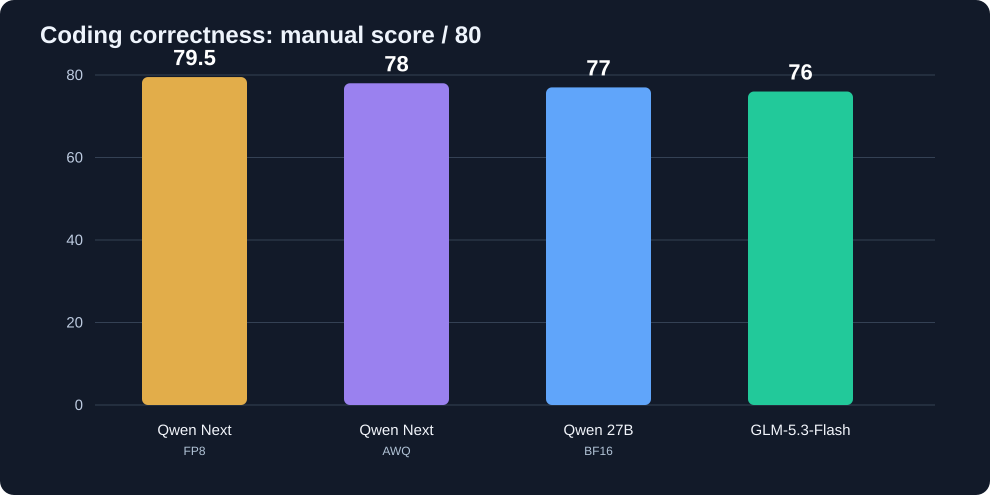
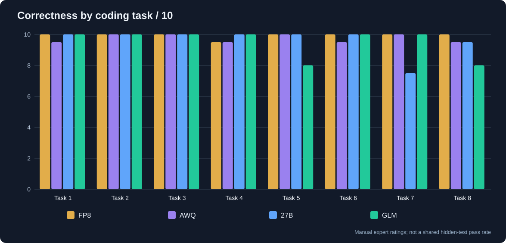

# Восемь coding-задач: правильность GLM-5.3-Flash и трёх Qwen
**14 октября 2026 · [English](RESULTS_EN.md) · [Исходные условия без решений](TASKS_ONLY_RU.md) · [Первоначальная статья Qwen](../../flash-next-awq-vs-fp8/README_RU.md)**

**В этом отчёте сравнивается только правильность решений. Временные показатели GLM исключены.** Во время её прогона на том же сервере работали ещё две параллельные нагрузки, поэтому использовать продолжительность агентных обращений для сравнения с Qwen было бы неправильно. Графики времени и соответствующий CSV удалены из текущего раздела.

## Оценка задач

В предыдущей статье Qwen уже получали ручные баллы **по шкале 0–10 за задачу**. Теперь той же экспертной шкалой оценён и GLM. **Итог GLM: 76/80.** Это именно оценка правильности ответов, **не рейтинг скорости и не доля пройденных одинаковых скрытых тестов**. Баллы GLM выставлены после анализа её кода, повторного запуска доступных тестов и воспроизведения контрпримеров; для SQL и полного набора TypeScript проверка менее полная, что отдельно отмечено ниже.

| № | Задача | Qwen Next FP8 | Qwen Next AWQ | Qwen 27B BF16 | **GLM-5.3** |
|---:|---|---:|---:|---:|---:|
| 1 | Python: группировка сессий | 10 | 9,5 | 10 | **10** |
| 2 | AsyncCache | 10 | 10 | 10 | **10** |
| 3 | Покрывающий диапазон | 10 | 10 | 10 | **10** |
| 4 | PostgreSQL | 9,5 | 9,5 | 10 | **10** |
| 5 | TypeScript parsePort | 10 | 10 | 10 | **8** |
| 6 | Storage / email | 10 | 9,5 | 10 | **10** |
| 7 | LRU + TTL | 10 | 10 | 7,5 | **10** |
| 8 | Async run_jobs | 10 | 9,5 | 9,5 | **8** |
| **Итого / 80** | **Экспертная оценка правильности** | **79,5** | **78** | **77** | **76** |

**За что снижены баллы GLM:**

- **Задача 5: 8/10.** Реализация выбрасывает `RangeError` для `parsePort("8080abc", 3000)` вместо возврата fallback по опубликованному эталону. Формулировка «отклонять» допускает неоднозначность, поэтому важнее второй, более объективный дефект: `parsePort(8080, 0)` возвращает `8080`, хотя в исходном ТЗ сказано, что некорректный fallback обязан давать `RangeError`. Оба случая воспроизведены.
- **Задача 8: 8/10.** Если одна job самостоятельно бросает `asyncio.CancelledError`, программа отменяет общий запуск и остальные воркеры вместо изоляции сбоя отдельной job. Это воспроизводимое нарушение условия «исключение одной job не отменяет остальные».

**Почему остальные задачи без штрафа:** по задачам 1–3 код и повторно выполненные тесты подтверждают правильность; по SQL (№4) в журнале есть реальные PostgreSQL-проверки, хотя независимый деплой не выполнялся. Задача 6 отвечает исходным кратким требованиям об email и копиях объектов, несмотря на отличающийся от эталона интерфейс. В задаче 7 найден дефект **дополнительной** функции индивидуальных TTL, не входившей в исходное задание, поэтому баллы за это не снимаются.

## Разбор спорных решений GLM

**Задача 5 — `parsePort`.** Кроме отличия при `parsePort("8080abc", 3000)`, подтверждено, что `parsePort(8080, 0)` не проверяет неверный `fallback` и возвращает 8080. Последнее непосредственно расходится с требованием выбрасывать `RangeError` при невалидном fallback. **8/10**.

**Задача 6 — Storage.** В эталоне `register(email, name)` / `login(email)`, у GLM реализовано другое TypeScript API с паролем: `register(email, password)` / `login(email, password)`. При этом ключевые требования о регистронезависимом email и защите объектов от изменения реализованы. Основные TS-модули компилируются; полный пакет Node-тестов вне среды агента независимо не воспроизводился.

**Задача 7 — TTLCache.** Проверенный дефект проявляется в **добавленной самой GLM возможности задавать индивидуальные TTL на put**: ограниченная очистка может вытеснить живой ключ, пока в словаре есть истёкший. Однако исходное краткое ТЗ индивидуальные TTL не запрашивало. **Не вычитаем баллы за дополнительную функциональность**, пока не сформируем общий тест, относящийся именно к исходному контракту.

**Задача 8 — `run_jobs`.** Контрпример с job, самостоятельно вызывающей `asyncio.CancelledError`, приводит к общей отмене и нарушает условие «исключение одной job не отменяет остальные». Здесь отклонение от исходного контракта воспроизводимо. Собственные зелёные тесты GLM этот случай пропустили. **8/10**.

## Подтверждение исполнения

- Python-тесты моделей GLM для задач **1, 2, 3 и 8** повторно запускались в независимом окружении и проходили. Отдельный новый тест для задачи 8 выявил указанную ошибку.
- Для задачи 4 PostgreSQL 16 реально использовался внутри агента; независимое пересоздание БД в этом отчёте не выполнялось.
- TS-модули 5–7 компилировались независимо; отдельные полные Node-сценарии из среды агента не восстановлены. Зелёные самопроверки модели не равны общему скрытому набору.

## Ограничения экспертной оценки /80

**76/80 — выставленная экспертная оценка на основании имеющихся решений.** Она сопоставима с прежними ручными баллами Qwen по подходу к оценке, но не заменяет одинаковый независимый скрытый набор тестов для всех четырёх моделей. Для более строгого рейтинга стоит уточнить контракт `parsePort`, зафиксировать API Storage и провести общие граничные проверки `CancelledError`.

Сырые архивы агентных сессий не опубликованы: в них могут содержаться локальные пути, команды и лишние сведения об окружении. Отчёт описывает установленную правильность и ограничения проверки, **не делает выводов по времени или скорости этих восьми задач**.
